 

**[Toolbox](#toolbox)** &nbsp;&nbsp;|&nbsp;&nbsp; **[Projects](#projects)** &nbsp;&nbsp;|&nbsp;&nbsp; **[Experience](#experience)** &nbsp;&nbsp;|&nbsp;&nbsp; **[Education](#education)** &nbsp;&nbsp;|&nbsp;&nbsp; **[Contact](#contact)**

 

I build, train, and evaluate machine learning models on real data, 
and I treat preprocessing, honest metrics, and documentation as part of the model. 
Currently finishing a B.Sc. in Machine Learning and taking on remote AI/ML work.

 

 

 

 

<h2 align="center" id="toolbox">Toolbox</h2>

  

<table>
  <tr>
    <td align="center" width="33%"><b>Machine Learning</b> Scikit-learn · TensorFlow · PyTorch Deep Learning · Feature Engineering Model Evaluation</td>
    <td align="center" width="33%"><b>Data</b> Python · NumPy · Pandas · SQL Data Preprocessing · Cleaning Matplotlib · Seaborn</td>
    <td align="center" width="33%"><b>Engineering</b> Python · C++ · Algorithms Git &amp; GitHub · Linux Competitive Programming (ECPC)</td>
  </tr>
</table>

 

 

<h2 align="center" id="projects">Projects</h2>

Click a project to expand it

<b>RAG Chatbot</b> &nbsp;·&nbsp; answers grounded in your own documents

 

A retrieval-augmented generation chatbot that answers questions using custom documents as context. It combines document preprocessing, semantic search, retrieval, and LLM-based response generation to produce relevant, grounded answers.

- Chunks and embeds documents, then retrieves the closest matches for each question
- Passes the retrieved context to the LLM so answers stay tied to the source material
- Shows the source chunks behind each answer

 

<b>Hybrid Clustering Analyzer</b> &nbsp;·&nbsp; three algorithms, one ranked comparison

 

An interactive clustering analysis tool for exploring patterns in datasets with unsupervised learning. It groups similar data points, visualizes the results, and makes patterns easier to interpret.

- Runs K-Means, DBSCAN, and Gaussian Mixture Models on the same preprocessed data
- Detects the K-Means cluster count with an elbow-method heuristic
- Ranks models by Silhouette, Davies-Bouldin, and Calinski-Harabasz scores
- Flask and scikit-learn API with a React and TypeScript interface

 

<b>AI Resume Analyzer</b> &nbsp;·&nbsp; ATS-aware resume feedback

 

A Python application that analyzes resume content and gives feedback to improve job relevance and ATS compatibility.

- Text extraction from resumes
- Keyword matching against job requirements
- Resume scoring and structured feedback generation

 

<b>Superstore Sales Report System</b> &nbsp;·&nbsp; from raw orders to a BI dashboard

 

An end-to-end sales analysis workflow: data cleaning, feature engineering, a Logistic Regression classifier that flags high-sales orders, and a Power BI dashboard for business reporting.

- Cleans 5,901 order records and engineers features such as shipping days and sales per item
- Evaluates the model with a classification report, confusion matrix, and ROC curve
- Delivers results in a Power BI dashboard

 

 

 

<h2 align="center" id="experience">Experience</h2>

<b>Machine Learning Engineer Intern</b> &nbsp;·&nbsp; Digital Egypt Pioneers Initiative &nbsp;·&nbsp; Jul 2025 – Dec 2025

 

Hybrid program: online sessions and in-person workshops at Menoufia University.

- Completed machine learning and AI training, learning preprocessing, cleaning, and analysis with Python, Pandas, and NumPy
- Trained and evaluated machine learning models on real-world datasets
- Implemented preprocessing techniques that cleaned and managed datasets, improving model accuracy
- Ran statistical analyses that validated model accuracy, leading to **20% better predictive insights** for client projects
- Documented processes, models, and results, improving team efficiency through better knowledge sharing

 

 

<h2 align="center" id="education">Education</h2>

<b>B.Sc. in Machine Learning</b> &nbsp;·&nbsp; Menofia National University &nbsp;·&nbsp; Sep 2023 – Present

 

GPA 3.3 / 4.0, graduating June 2027. Competitive programmer (ECPC) with a strong C++ and algorithmic foundation.

 

 

 

<h2 align="center" id="contact">Contact</h2>

Open to remote AI/ML engineering, model evaluation, and data work.

 

  

